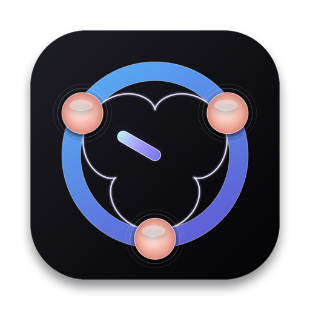
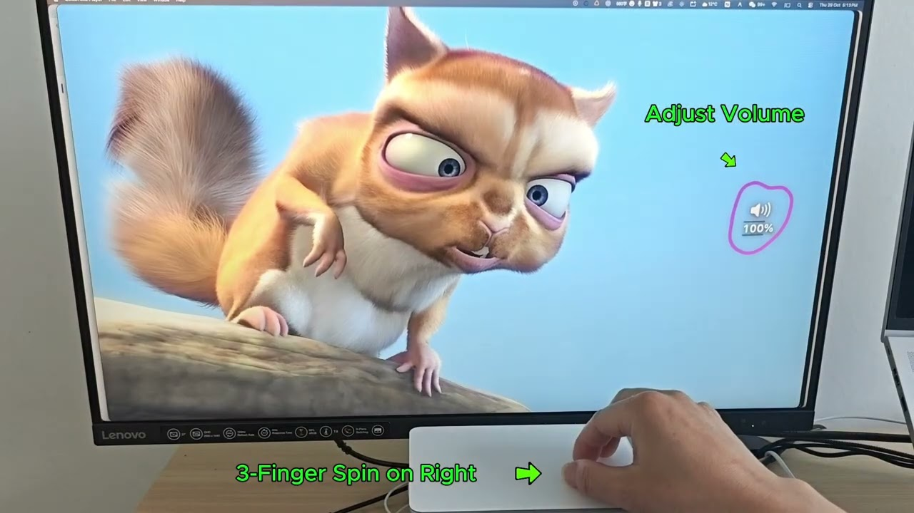
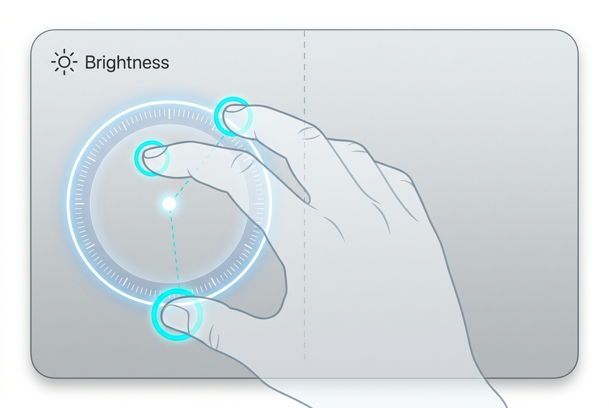
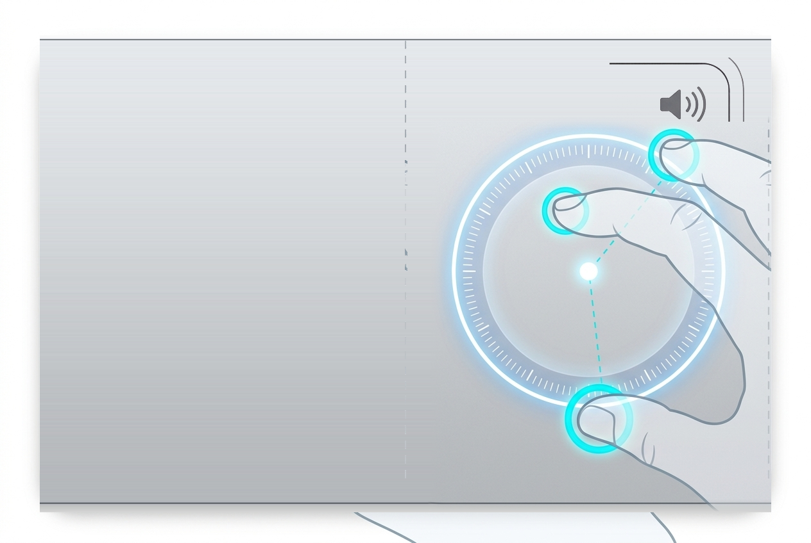

<p align="center">
  <a href="https://benwu232.github.io/Epicyclo/">
    
  </a>
</p>

<h1 align="center">Epicyclo</h1>

<p align="center">
  <b>Awaken the Hidden Dial Inside Your Trackpad.</b><br>
  Three-finger spin: brightness on the left, volume on the right. Eyes on the screen, fingers on the pad.
</p>

<p align="center">
  <a href="README.md"><b>English</b></a> |
  <a href="README_zh.md">简体中文</a> |
  <a href="https://benwu232.github.io/Epicyclo/">Official Website</a>
</p>

<p align="center">
  <a href="https://github.com/benwu232/Epicyclo/releases/download/v1.0.6/Epicyclo_v1.0.6.dmg"></a>
</p>

<p align="center">
  <a href="https://github.com/benwu232/homebrew-tap"></a>
  <a href="https://github.com/benwu232/Epicyclo/releases/latest"></a>
  
  
  
  
</p>

---

## Table of Contents

- [✨ Video Demonstration](#-video-demonstration)
- [🚀 Quick Start & Installation](#-quick-start--installation)
- [🎛️ Core Features & Dual Rotary Zones](#️-core-features--dual-rotary-zones)
  - [Left Zone: Display Brightness & DDC/CI](#left-zone-display-brightness--ddcci)
  - [Right Zone: System Volume & Audio](#right-zone-system-volume--audio)
  - [Jelly Knob Elastic Feedback](#jelly-knob-elastic-feedback)
  - [Seamless Three-Finger Drag Coexistence](#seamless-three-finger-drag-coexistence)
  - [GPU-Accelerated HUD Visuals](#gpu-accelerated-hud-visuals)
- [⚡ Interaction Comparison: Keys & Sliders vs. Epicyclo](#-interaction-comparison-keys--sliders-vs-epicyclo)
- [🛡️ Runs 100% Locally, Zero Privacy Compromises](#️-runs-100-locally-zero-privacy-compromises)
- [💎 Simple, Honest Pricing](#-simple-honest-pricing)
- [❓ Frequently Asked Questions (FAQ)](#-frequently-asked-questions-faq)
- [📬 Support & Feedback](#-support--feedback)

---

## ✨ Video Demonstration

Watch the three-finger rotary dial in action:

<p align="center">
  <a href="https://youtu.be/4AWLfFuUoUA">
    
  </a>
  <br>
  <em>▶ Click image to watch demo on YouTube (https://youtu.be/4AWLfFuUoUA)</em>
</p>

---

## 🚀 Quick Start & Installation

### Option A: Install via Homebrew (Recommended)

```bash
brew install --cask benwu232/tap/epicyclo
```

To upgrade later:
```bash
brew upgrade epicyclo
```

To uninstall:
```bash
brew uninstall --zap epicyclo
```

### Option B: Direct DMG Download

1. Download [`Epicyclo_v1.0.6.dmg`](https://github.com/benwu232/Epicyclo/releases/download/v1.0.6/Epicyclo_v1.0.6.dmg) from GitHub Releases.
2. Open the disk image and drag `Epicyclo.app` into your `Applications` folder.
3. Launch Epicyclo. It lives quietly in your macOS menu bar with zero setup required.

### Hardware & System Requirements

- **macOS**: macOS 13.0 (Ventura) or later (macOS 14 Sonoma & macOS 15 Sequoia fully supported).
- **Architecture**: Universal Binary (Apple Silicon M1/M2/M3/M4 & Intel 64-bit).
- **Trackpad**: MacBook built-in trackpad or standalone Apple Magic Trackpad.
- **Permissions**: **0 system permissions required** (no Accessibility, no Input Monitoring).

---

## 🎛️ Core Features & Dual Rotary Zones

Volume and brightness are continuous physical values naturally suited to rotary dials. Epicyclo divides your trackpad into two intuitive virtual dials:

<p align="center">
  
  &nbsp;
  
</p>

### Left Zone: Display Brightness & DDC/CI
- **Natural Rotation**: Rest three fingers on the left side of your trackpad and rotate naturally.
- **Built-in & External Displays**: Seamlessly controls your MacBook built-in Retina display.
- **DDC/CI Hardware Control (Pro)**: Communicates directly via the I2C / DDC-CI bus to adjust the real physical backlight of third-party external monitors (Dell, LG, Samsung, ASUS, BenQ, Philips, etc.) without extra heavy utilities.
- **Pointer Awareness**: Automatically targets whichever display currently holds your mouse cursor.

### Right Zone: System Volume & Audio
- **Instant Response**: Rest three fingers on the right side of your trackpad and spin.
- **Output Routing**: Controls built-in MacBook speakers, external headphones, or Bluetooth audio devices.
- **Native Feedback**: Includes silky-smooth real-time response and native macOS sound feedback tick.

### Jelly Knob Elastic Feedback
- **Organic Feel**: Instant, springy tactile feedback that moves dynamically with your fingertips.
- **Dynamic Physics**: The smoother and rounder your rotational gesture, the more fluid and frictionless the response feels.

### Seamless Three-Finger Drag Coexistence
- **Zero Conflict**: If you use macOS's native "Three-Finger Drag" (in Accessibility > Pointer Control > Trackpad Options), Epicyclo works alongside it without conflict.
- **Intelligent Disambiguation**: Built-in microsecond algorithms differentiate rotary dial gestures from linear three-finger drags upon touch, locking the dial state until fingers lift.

### GPU-Accelerated HUD Visuals
- **Silky 60/120 FPS**: Hardware-accelerated HUD rendering using Metal / CoreAnimation with near-zero CPU footprint (< 0.1% during spins, 0% idle).
- **Extensible Styles**: Classic Slide HUD with 50%–200% scaling, and an expanding library of premium aesthetic animations.

---

## ⚡ Interaction Comparison: Keys & Sliders vs. Epicyclo

| Dimension | Keyboard Shortcuts (Fn Keys / Touch Bar) | Menu Bar / Control Center Sliders | ✨ Epicyclo Trackpad Rotary Dial |
| :--- | :--- | :--- | :--- |
| **Adjustment Time** | 🟡 **Medium (1–2s)**<br>Must lift hands to top keyboard row | 🔴 **Slow (3–5s)**<br>Find cursor → click icon → drag slider | 🟢 **Instant (0.3s)**<br>Turn fingers where they already rest |
| **Adjustment Feel** | 🔴 **Discrete Jumps**<br>Repetitive tapping, tedious steps | 🟡 **Mouse Drag**<br>Constrained by tiny pixel sliders | 🟢 **Continuous Dial**<br>Analog rotary dynamics match light & sound |
| **Eyes-Free Blind Control** | 🔴 **Poor**<br>Short travel, Touch Bar lacks tactile feedback | 🔴 **Impossible**<br>Eyes must hunt and aim at narrow sliders | 🟢 **True Eyes-Free**<br>100% muscle memory, zero gaze shift |
| **Focus & Flow State** | 🟡 **Interrupted**<br>Glance down at keyboard, breaks flow | 🔴 **Severe Disruption**<br>Cursor leaves active workspace | 🟢 **Zero Disruption**<br>Eyes remain fixed on your creative task |
| **External Monitor Control** | 🔴 **Unsupported**<br>macOS Fn keys cannot dim 3rd-party monitors | 🔴 **Unsupported**<br>No unified hardware backlight control | 🟢 **Native DDC/CI Hardware Backlight Control (Pro)** |

---

## 🛡️ Runs 100% Locally, Zero Privacy Compromises

We believe exceptional Mac utilities must exercise utmost restraint and transparency, never touching unnecessary data.

- **Zero Permissions Required**: Operates out of the box without requesting Accessibility (`AXUIElement`) or Input Monitoring permissions.
- **Native Multitouch Events**: Reads raw low-level trackpad contact vectors directly through native macOS APIs without intercepting keystrokes or screen contents.
- **100% Local & Offline**: All gesture recognition, DDC/CI display communication, and HUD rendering run completely on your device. No analytics trackers, no telemetry, no network calls except for Sparkle update checks and anonymous crash reports.
- **Apple Notarized**: Every release is compiled, signed with an official Apple Developer ID, and notarized by Apple’s automated security scanning service, ensuring Gatekeeper verifies it cleanly.

---

## 💎 Simple, Honest Pricing

Epicyclo offers a transparent, honest pricing model. No subscriptions. No ads.

| Feature | Epicyclo Free ($0 Forever) | Epicyclo Premium ($6.18 Lifetime) |
| :--- | :---: | :---: |
| **Pricing** | **$0** (Free Forever) | **$6.18** (One-time purchase, Lifetime license) |
| **Pro Trial** | Full 14-day Pro trial included | Lifetime ownership |
| **Core 3-Finger Volume & Built-in Brightness** | ✅ Included forever | ✅ Included |
| **Zero Permissions Architecture** | ✅ Included | ✅ Included |
| **Classic Slide HUD (50%–200% Scale)** | ✅ Included | ✅ Included |
| **External 3rd-Party Monitor DDC/CI Backlight** | 14-day trial | ✅ **Unlimited Hardware Control** |
| **All Premium HUD Animation Effects** | 10 trials / day | ✅ **Unlimited Access** |
| **Lifetime Updates & Future Styles** | Minor updates | ✅ **Free Lifetime Upgrades** |
| **Device Activations** | 1 Mac | ✅ **Up to 3 Macs under personal account** |

> 💡 **Why \$6.18?** $\frac{10}{\phi} \approx 6.18$, where $\phi = 1.618033...$ is the Golden Ratio — representing geometric elegance and balance.

---

## ❓ Frequently Asked Questions (FAQ)

<details>
<summary><b>Why isn't Epicyclo available on the Mac App Store?</b></summary>
<br>
Apple’s Mac App Store sandbox strictly prohibits apps from accessing raw low-level trackpad multitouch event streams and communicating directly with external displays via the I2C / DDC-CI hardware bus (the exact same technical reason why tools like Raycast and Alfred distribute independently).

To achieve custom rotary dial gesture algorithms and direct hardware backlight control, Epicyclo is distributed directly via our website.

🛡️ **Security Guarantee**: Epicyclo embraces a minimalist security philosophy—it requires **zero system permissions** and collects **zero personal data aside from anonymous crash reports**. Furthermore, each build is **Apple Notarized** and Developer ID signed, installing cleanly through macOS Gatekeeper.
</details>

<details>
<summary><b>Will Epicyclo interfere with macOS native Three-Finger Drag?</b></summary>
<br>
<b>Not at all—they coexist seamlessly!</b> Epicyclo’s built-in algorithm automatically distinguishes between rotary dials and three-finger drags within milliseconds upon touch. Once locked, it stays securely engaged until your fingers lift.
</details>

<details>
<summary><b>Does Epicyclo require Accessibility (AX) or Input Monitoring permissions?</b></summary>
<br>
<b>Absolutely not!</b> This is a defining architectural advantage of Epicyclo. Built upon native trackpad events, it completely eliminates the need for sensitive Accessibility or Input Monitoring permissions. Safe, lightweight, and energy-efficient.
</details>

<details>
<summary><b>Does it work with an external Magic Trackpad?</b></summary>
<br>
Yes, seamlessly. Whether using an integrated MacBook trackpad or a standalone Apple Magic Trackpad over Bluetooth or USB-C, Epicyclo delivers the same real-time responsiveness on macOS 13 (Ventura) and above.
</details>

<details>
<summary><b>Why doesn't my external monitor brightness respond?</b></summary>
<br>
Most commercial displays (Dell, LG, Samsung, Philips, ASUS, etc.) support DDC/CI out of the box. Ensure "DDC/CI" is toggled ON in your monitor’s physical on-screen menu. Note that some unpowered USB-C adapters or hubs block I2C signals; connecting directly or via a DDC-compatible Thunderbolt dock is recommended.
</details>

<details>
<summary><b>How many Macs can I activate on one license? How do I transfer?</b></summary>
<br>
Each Epicyclo Premium license covers up to 3 Macs under your personal ownership (e.g., an office MacBook, a home Mac mini, and a portable laptop).

When upgrading machines or reinstalling the OS, simply click "Deactivate" in Epicyclo’s settings on the old Mac, or reset device slots anytime through your Lemon Squeezy customer portal link sent upon purchase.
</details>

<details>
<summary><b>Does Epicyclo drain battery or consume CPU?</b></summary>
<br>
Virtually zero drain, completely unnoticeable on battery life. The dial remains completely idle most of the time with 0% CPU usage. Lightweight computations occur only during the brief milliseconds of three-finger rotation, while HUD animations are fully GPU hardware-accelerated. Since daily rotary tweaks take only about a second, battery consumption is imperceptible in practice.
</details>

<details>
<summary><b>How do I uninstall Epicyclo?</b></summary>
<br>
Identical to any native macOS app: quit Epicyclo from the menu bar, then drag `Epicyclo.app` from Finder &gt; Applications directly into the Trash. Epicyclo adheres to a clean architecture—it installs no background daemons, drivers, or kernel extensions, leaving zero clutter behind.
</details>

---

## 📬 Support & Feedback

- 🐛 **Bug Reports & Feature Ideas**: Found an edge case or have a gesture suggestion? [Open an Issue on GitHub](https://github.com/benwu232/Epicyclo/issues).
- ✉️ **Customer Support & Inquiries**: For volume licensing, order inquiries, press, or private assistance, please email us at [epicyclo232@gmail.com](mailto:epicyclo232@gmail.com).
- 🌐 **Official Website**: [https://benwu232.github.io/Epicyclo/](https://benwu232.github.io/Epicyclo/)

---

<p align="center">
  <sub>Crafted with precision for macOS · Copyright © 2026 Epicyclo. All rights reserved.</sub>
</p>
