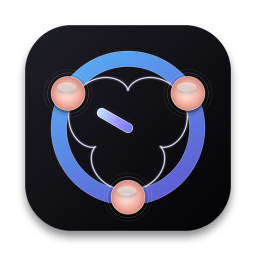
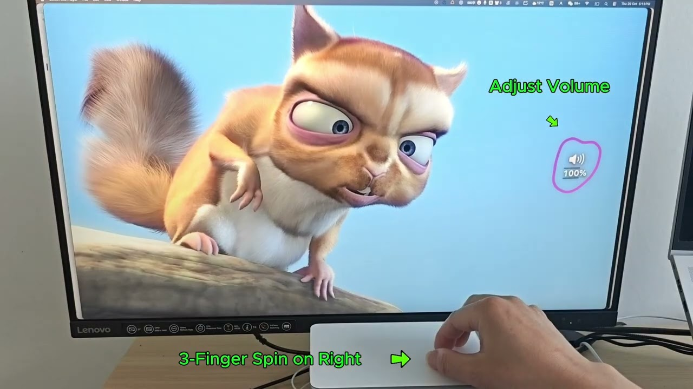
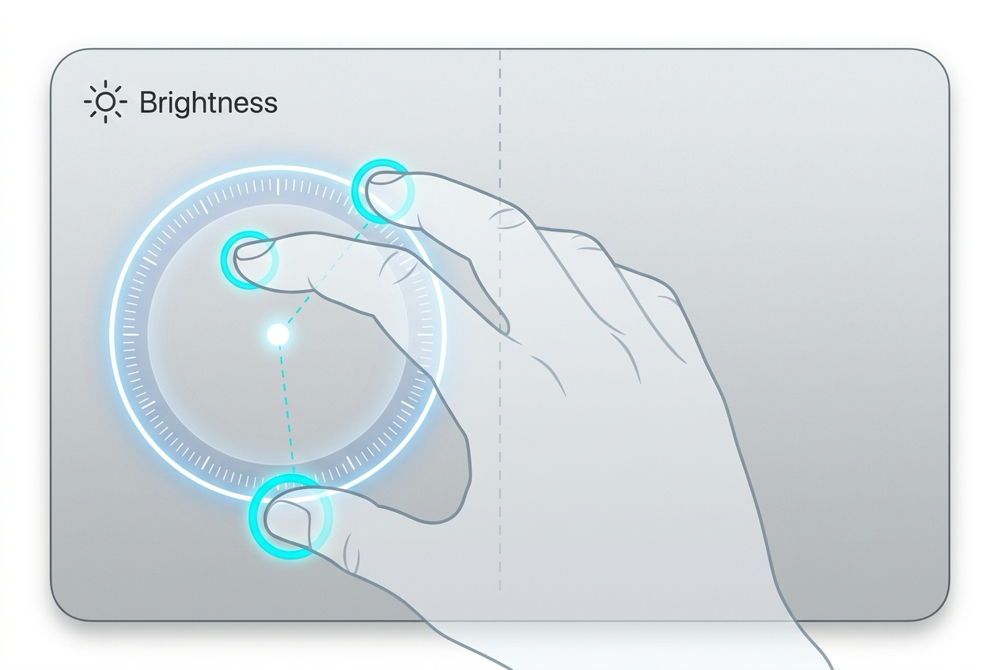
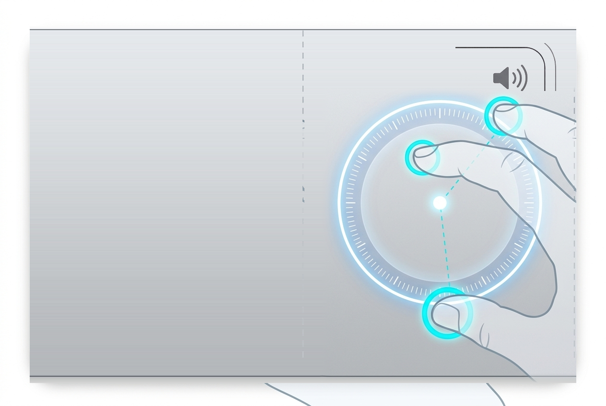

<p align="center">
  <a href="https://benwu232.github.io/Epicyclo/index_zh.html">
    
  </a>
</p>

<h1 align="center">Epicyclo</h1>

<p align="center">
  <b>唤醒沉睡在触控板里的旋钮。</b><br>
  三指轻旋：左调亮度，右控音量；目不离屏，指不离板。
</p>

<p align="center">
  <a href="README.md">English</a> |
  <a href="README_zh.md"><b>简体中文</b></a> |
  <a href="https://benwu232.github.io/Epicyclo/index_zh.html">官方主页</a>
</p>

<p align="center">
  <a href="https://github.com/benwu232/Epicyclo/releases/download/v1.0.6/Epicyclo_v1.0.6.dmg"></a>
</p>

<p align="center">
  <a href="https://github.com/benwu232/homebrew-tap"></a>
  <a href="https://github.com/benwu232/Epicyclo/releases/latest"></a>
  
  
  
  
</p>

---

## 目录

- [✨ 视频演示](#-视频演示)
- [🚀 快速开始与安装](#-快速开始与安装)
- [🎛️ 核心功能与双区旋钮](#️-核心功能与双区旋钮)
  - [左侧旋钮区：屏幕亮度与外接屏硬件调光 (DDC/CI)](#左侧旋钮区屏幕亮度与外接屏硬件调光-ddcci)
  - [右侧旋钮区：系统音量与原生音效反馈](#右侧旋钮区系统音量与原生音效反馈)
  - [果冻旋钮弹性物理反馈](#果冻旋钮弹性物理反馈)
  - [无缝共存 macOS 原生三指拖移](#无缝共存-macos-原生三指拖移)
  - [GPU 硬件加速 HUD 动效](#gpu-硬件加速-hud-动效)
- [⚡ 交互维度深度对比：按键、滑块与旋钮](#-交互维度深度对比按键滑块与旋钮)
- [🛡️ 100% 本地运行，零隐私妥协](#️-100-本地运行零隐私妥协)
- [💎 简单透明的付费模式](#-简单透明的付费模式)
- [❓ 常见问题解答 (FAQ)](#-常见问题解答-faq)
- [📬 支持与反馈](#-支持与反馈)

---

## ✨ 视频演示

一分钟直观感受 Mac 触控板上的拟真物理旋钮交互：

<p align="center">
  <a href="https://youtu.be/4AWLfFuUoUA">
    
  </a>
  <br>
  <em>▶ 点击上方图片前往 YouTube 观看演示视频 (https://youtu.be/4AWLfFuUoUA)</em>
</p>

---

## 🚀 快速开始与安装

### 方式一：通过 Homebrew 安装（推荐）

```bash
brew install --cask benwu232/tap/epicyclo
```

后续升级软件：
```bash
brew upgrade epicyclo
```

卸载软件：
```bash
brew uninstall --zap epicyclo
```

### 方式二：直接下载 DMG 安装包

1. 从 GitHub Releases 下载最新版 [`Epicyclo_v1.0.6.dmg`](https://github.com/benwu232/Epicyclo/releases/download/v1.0.6/Epicyclo_v1.0.6.dmg)。
2. 双击打开磁盘镜像，将 `Epicyclo.app` 拖拽至系统的 `Applications`（应用程序）文件夹。
3. 启动 Epicyclo 即可，常驻顶部菜单栏，开箱即用，无需任何复杂配置。

### 硬件与系统要求

- **操作系统**：macOS 13.0 (Ventura) 及以上版本（完美支持 macOS 14 Sonoma 与 macOS 15 Sequoia）。
- **芯片架构**：通用二进制 Universal Binary（原生支持 Apple Silicon M1/M2/M3/M4 系列及 Intel 64位）。
- **触控板设备**：MacBook 内置触控板或独立 Apple Magic Trackpad（妙控板）。
- **权限依赖**：**0 系统权限依赖**（无需开启辅助功能、无需输入监控）。

---

## 🎛️ 核心功能与双区旋钮

音量和亮度是连续物理量，天然契合旋钮调控。Epicyclo 将触控板划分为左右两个符合直觉的虚拟盲操旋钮区：

<p align="center">
  
  &nbsp;
  
</p>

### 左侧旋钮区：屏幕亮度与外接屏硬件调光 (DDC/CI)
- **自然旋转**：三指轻触触控板左半区，画弧旋转即可顺滑调光。
- **内置屏与外接屏统一管理**：完美调节 MacBook 内置高动态 Retina 屏幕。
- **DDC/CI 真实硬件背光调光 (Pro)**：直接通过 I2C / DDC-CI 总线协议向外接显示器（如 Dell、LG、三星、华硕、明基、飞利浦等）发送硬件级背光调光指令，无需额外安装臃肿的第三方亮度工具。
- **光标自动跟随定位**：当连接多台显示器时，自动识别鼠标指针所在屏幕进行精准调节。

### 右侧旋钮区：系统音量与原生音效反馈
- **毫秒级响应**：三指轻触触控板右半区，顺时针放大音量、逆时针减小音量。
- **多音频设备支持**：无论当前输出为 MacBook 内置扬声器、外接有线耳机还是蓝牙耳机，均可稳定调控。
- **原生音效反馈**：支持伴随旋转发出 macOS 原生步进反馈音，盲操心中有数。

### 果冻旋钮弹性物理反馈
- **触觉拟真**：灵动果冻回弹力学反馈，HUD 与手指转动轨迹紧密贴合。
- **画圆物理交互**：手势越圆，调控手感越丝滑流畅；停转即锁定，抬指即隐退。

### 无缝共存 macOS 原生三指拖移
- **互不干扰**：即便在系统设置中长期开启了「辅助功能 > 指针控制 > 触控板选项 > 三指拖移」，也不会与 Epicyclo 冲突。
- **毫秒级手势分流**：触点落板瞬间，内置算法会在毫秒内精准辨别“三指旋转”与“三指平移拖拽”，锁定旋钮状态后绝不误触发窗口拖移。

### GPU 硬件加速 HUD 动效
- **极致丝滑**：基于 Metal / CoreAnimation 硬件加速，CPU 占用极低（仅在手势旋转的短暂毫秒内进行微量计算，平时 0% 待机）。
- **个性化视觉**：经典平滑 Slide HUD 支持 50%～200% 自定义缩放，更多高阶先锋美学 HUD 动效持续扩充。

---

## ⚡ 交互维度深度对比：按键、滑块与旋钮

| 对比维度 | 传统键盘快捷键 (物理 Fn 键 / Touch Bar) | 菜单栏 / 控制中心滑块 UI | ✨ Epicyclo 触控板物理旋钮 |
| :--- | :--- | :--- | :--- |
| **调控耗时** | 🟡 **中等 (1-2s)**<br>手部需大幅抬起离开触控板移至顶排按键 | 🔴 **缓慢 (3-5s)**<br>视线找光标 → 移动点击图标 → 拖动狭小滑块 | 🟢 **瞬间 (0.3s)**<br>手指就在触控板上，三指轻旋即调 |
| **调节手感** | 🔴 **离散阶梯跳跃**<br>连续多下生硬敲击，微调繁琐 | 🟡 **鼠标线性拖拽**<br>受限于细小像素滑轨，易失误 | 🟢 **连续旋钮流体手感**<br>连续物理量旋转体验，契合声与光 |
| **盲操盲控** | 🔴 **体验差**<br>键程短易按错；Touch Bar 全无盲操反馈 | 🔴 **无法盲操**<br>视线必须全程盯着狭窄滑块 | 🟢 **真正盲操肌肉记忆**<br>完全脱离视线依赖，100% 肌肉记忆 |
| **专注力打断** | 🟡 **被打断**<br>视线下移寻找键盘，阅读思路被打断 | 🔴 **严重打断**<br>鼠标指针离开当前工作视区，上下文割裂 | 🟢 **零专注力打断**<br>视线无需移开屏幕，心流持续在线 |
| **外接显示器硬件支持** | 🔴 **不支持**<br>原生快捷键无法调节绝大多数第三方外接屏背光 | 🔴 **不支持**<br>缺乏统一便捷的硬件级背光控制 | 🟢 **原生支持 DDC/CI 硬件级背光直调 (Pro)** |

---

## 🛡️ 100% 本地运行，零隐私妥协

我们坚持优秀且克制的 Mac 原生工具哲学，绝不索取任何非必要权限与数据：

- **0 系统权限依赖**：开箱即用，**完全无需**开启可能危及用户隐私的“辅助功能（Accessibility）”或“输入监控（Input Monitoring）”权限。
- **原生多点触控事件流**：直接通过 macOS 原生 Multitouch API 获取指尖触点几何相对位移，不监听键盘打字、不截取屏幕画面。
- **100% 本地化运行**：手势识别、DDC/CI 通信与 HUD 渲染均在本地芯片即时完成，无网络常驻连接，仅保留 Sparkle 自动更新检查与匿名崩溃排查。
- **Apple 官方公证（Apple Notarized）**：每个正式发布版本均由苹果官方开发者证书签名，并通过 Apple 安全服务器公证，macOS Gatekeeper 绿色验证，安全无忧。

---

## 💎 简单透明的付费模式

Epicyclo 采用极简清爽的付费设计，无强制订阅，拒绝广告打扰：

| 功能特性 | Epicyclo 免费版 ($0 永久使用) | Epicyclo Premium ($6.18 终身买断) |
| :--- | :---: | :---: |
| **价格** | **$0** (永久免费) | **$6.18** (一次性买断，终身授权) |
| **试用政策** | 包含 14 天全功能完整试用 | 终身所有权 |
| **三指双区盲操调音量与内置屏幕亮度** | ✅ 永久免费保留 | ✅ 包含 |
| **0 权限依赖纯净安全架构** | ✅ 包含 | ✅ 包含 |
| **经典 Slide HUD 动效 (50%~200% 缩放)** | ✅ 包含 | ✅ 包含 |
| **第三方外接显示器 DDC/CI 硬件背光调节** | 14 天试用 | ✅ **无限制硬件直调** |
| **全部高阶 HUD 动效库** | 每日免费体验 10 次 | ✅ **无限制随心切换** |
| **终身免费升级与未来动效** | 基础维护更新 | ✅ **未来所有大版本及新动效终身免费升级** |
| **设备授权席位** | 1 台 Mac | ✅ **个人名下支持 3 台 Mac 同时激活** |

> 💡 **为什么定价为 \$6.18？** $\frac{10}{\phi} \approx 6.18$，其中 $\phi = 1.618033...$ 为黄金分割比（Golden Ratio），寓意几何常数与设计美学的纯粹融合。

---

## ❓ 常见问题解答 (FAQ)

<details>
<summary><b>为什么 Epicyclo 没有在 Mac App Store 上架？</b></summary>
<br>
苹果 Mac App Store 强制推行的“App 沙盒机制（App Sandbox）”，严格禁止任何第三方软件直接读取触控板多点触控的底层原始数据流，更禁止直接与外接显示器的底层总线（I2C / DDC-CI）进行硬件通信（这也是 Raycast、Alfred 等专业级 Mac 工具未能在 App Store 存在的硬性技术原因）。<br><br>
为了实现旋钮手势算法与真实硬件背光直调，Epicyclo 采用官网独立分发。<br><br>
🛡️ <b>安全保证</b>：Epicyclo 遵循极简安全哲学，完全无需开启任何权限，不收集除崩溃报告外的任何用户数据；同时已通过 <b>Apple 官方公证（Apple Notarized）</b>与开发者签名，可通过 macOS Gatekeeper 正常安装，请放心下载。
</details>

<details>
<summary><b>我平时开着 macOS 的「三指拖移」，会与 Epicyclo 冲突吗？</b></summary>
<br>
<b>完全不会，无缝共存！</b> Epicyclo 内置算法会自动区分“三指旋钮”和“三指拖移”，在检测到三个触点后在毫秒级迅速识别手势，一旦锁定，持续到手指抬起。
</details>

<details>
<summary><b>Epicyclo 需要开启辅助功能（Accessibility）权限吗？</b></summary>
<br>
<b>完全不需要！</b> 这是 Epicyclo 与其它同类软件最大的不同。Epicyclo 基于底层原生触控板事件驱动，完全无需开启可能危及隐私的“辅助功能”或“输入监控”权限，既安全、轻巧又省电。
</details>

<details>
<summary><b>支持 Magic Trackpad 外接触控板吗？</b></summary>
<br>
完美支持。无论是 MacBook 自带的触控板，还是桌面搭配的 Apple 妙控板（Magic Trackpad），只要系统为 macOS 13 (Ventura) 及以上版本均可无缝使用。
</details>

<details>
<summary><b>为什么我的外接显示器调节亮度没有反应？</b></summary>
<br>
大多数主流品牌的显示器（戴尔、LG、三星、飞利浦、华硕等）默认支持并通过 DDC/CI 协议通信。如果未生效，请检查显示器硬件 OSD 菜单中是否开启了“DDC/CI”选项。部分转接头或拓展坞可能会阻断 I2C 信号，建议直连或使用支持 DDC 的雷电拓展坞。
</details>

<details>
<summary><b>一个授权码可以在几台 Mac 上使用？换电脑如何迁移？</b></summary>
<br>
Epicyclo Premium 授权支持个人名下最多 3 台 Mac 同时激活使用（例如一台办公用 MacBook、一台家庭 Mac mini、一台随身笔记本）。<br><br>
更换新电脑或重装系统时，只需在旧电脑的 Epicyclo 设置中点击「反激活（Deactivate）」，或通过购买凭证邮件中的 Lemon Squeezy 客户门户重置激活席位，即可在新设备上继续使用。
</details>

<details>
<summary><b>Epicyclo 会消耗电量或占用 CPU 资源吗？</b></summary>
<br>
日常几乎零消耗，对电池续航完全无感知。旋钮绝大部分时间处于静止待命状态，CPU 占用率为 0%；仅在三指旋转的瞬间进行毫秒级低开销计算，HUD 动效全程由 GPU 硬件加速渲染。因为日常调控一次仅耗时一秒左右，实际使用中完全感觉不到电量消耗。
</details>

<details>
<summary><b>如果不需要了，如何彻底卸载 Epicyclo？</b></summary>
<br>
与标准的 macOS 原生软件完全一致：在顶部菜单栏退出 Epicyclo，然后直接将「访达 > 应用程序」中的 `Epicyclo.app` 拖入废纸篓即可。Epicyclo 恪守纯粹架构，不安装任何后台常驻守护进程（Daemon）、不修改系统文件，干净无残留。
</details>

---

## 📬 支持与反馈

- 🐛 **提交 Bug 或功能建议**：遇到边界异常或有新的手势交互想法？欢迎在 [GitHub Issues](https://github.com/benwu232/Epicyclo/issues) 提交反馈。
- ✉️ **客户支持与商务咨询**：批量授权、订单帮助或任何反馈，欢迎随时发送邮件至 [epicyclo232@gmail.com](mailto:epicyclo232@gmail.com)。
- 🌐 **官方主页**：[https://benwu232.github.io/Epicyclo/index_zh.html](https://benwu232.github.io/Epicyclo/index_zh.html)

---

<p align="center">
  <sub>Crafted with precision for macOS · Copyright © 2026 Epicyclo. All rights reserved.</sub>
</p>
